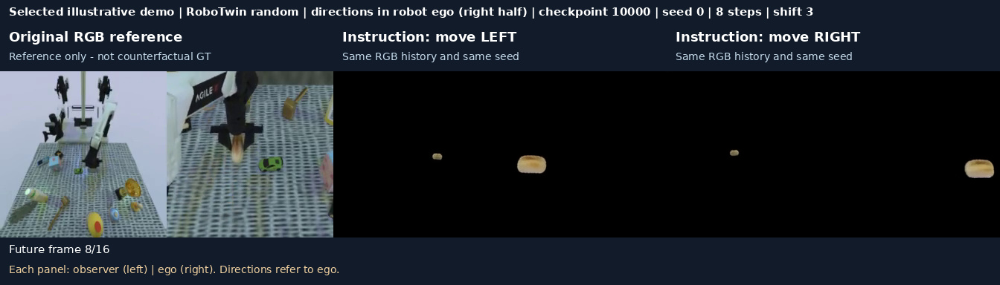
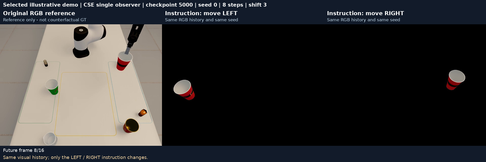

# Language-Conditioned Object-Only Video Prediction（OVP）

OVP 基于 VPP2 / Wan2.1，进行 **语言条件下的物体视频预测**：输入全景 RGB 首帧、历史帧和英文动作计划，预测黑背景上的未来物体视频。

这里保存 RoboTwin clean 版本的适配代码、配置与恢复材料，以及 RoboTwin random 和 CSE 的 checkpoint、训练与恢复说明。**权重在 Hugging Face，使用入口见下表。**

## 语言指令跟随 Demo

固定同一段全景 RGB 历史、预测起点和随机种子，仅把动作计划中的移动方向由 **left** 改为 **right**，比较物体未来轨迹。两个视频均先播放观测历史，再展示 **原录像未来 RGB / 向左预测 / 向右预测** 三栏对比。

### RoboTwin random：面包卷的左右移动

方向以拼接画面右半幅的 **robot ego** 视角为准。点击封面播放视频：

[](assets/demos/robotwin_random_direction_demo.mp4)

[播放 RoboTwin random Demo](assets/demos/robotwin_random_direction_demo.mp4) · [输入指令与参数](docs/inference_demos.md#robotwin-random-demo)

### CSE：已抬起红杯的左右移动

方向以单个 **observer** 视角为准。点击封面播放视频：

[](assets/demos/cse_direction_demo.mp4)

[播放 CSE Demo](assets/demos/cse_direction_demo.mp4) · [输入指令与参数](docs/inference_demos.md#cse-demo)

以上为选定的 seed=0 定性样例（8 步去噪、shift=3）。左栏是原录像参考，不是左右两条指令各自的真值；这些样例展示语言条件改变时的预测响应，不代表完整测试集成功率。场景、prompt、seed 选择和本地来源见 [Demo 完整说明](docs/inference_demos.md)。

## 模型与下载

| 模型 | 输入画面（宽 × 高） | 已保存权重 | 使用入口 |
| --- | --- | --- | --- |
| **RoboTwin clean · 10000 step** | observer 左 / ego 右，448×224 | `step_010000.pt`，HF 公开仓库，完整 BF16 DiT | [权重下载与恢复](backups/step_010000_20261026/README.md) · [训练与推理](docs/robotwin_clean_training.md) |
| **RoboTwin random · 10000 step** | observer 左 / ego 右，448×224 | `step_010000.pt`，HF 公开仓库，含训练配置备份 | [下载、训练与恢复](docs/robotwin_random_step10000_checkpoint.md) |
| **CSE · 5000 step** | 单 observer，640×480 | `step_005000.pt`，HF 公开仓库，已上传校验 | [下载、训练设置与评测](docs/cse_step5000_checkpoint.md) |

三个模型均使用 **9 帧 RGB 条件 → 16 帧物体未来**；历史窗口包含当前帧，另加 episode 首帧。时间间隔应按各自的数据约定解释：RoboTwin clean / random 使用去重后的帧索引，CSE 使用其 30 fps 视频索引。

权重初始化关系已经核对：

```text
VPP2 Stage-2 → RoboTwin clean 10k → RoboTwin random 10k → CSE 5k
```

步数按各数据阶段计数。clean 与 random 的文件都叫 `step_010000.pt`，请按模型仓库和 SHA-256 区分，并使用独立下载目录。

GitHub 当前代码和配置主要对应 clean 版本。random 的 HF 备份另含训练配置，但运行时有未包含在该 GitHub 提交中的代码修改；CSE 的单视角代码与运行配置也未随权重完整发布。使用前请查看各自文档的恢复范围。

## 按用途阅读

| 我想做什么 | 从哪里开始 |
| --- | --- |
| 查看语言指令跟随的视频、prompt 和对照条件 | [Demo 完整说明](docs/inference_demos.md) |
| 下载 CSE 5k，了解输入输出和 3k / 5k 评测 | [CSE checkpoint 说明](docs/cse_step5000_checkpoint.md) |
| 下载 RoboTwin random 10k，了解与 clean / CSE 的关系 | [random checkpoint 说明](docs/robotwin_random_step10000_checkpoint.md) |
| 下载并恢复 RoboTwin clean 10k | [备份恢复指南](backups/step_010000_20261026/README.md) |
| 了解 clean 实际训练参数、运行推理 | [RoboTwin clean 训练与推理](docs/robotwin_clean_training.md) |
| 准备 RGB / obj 数据、划分 train / test、使用 prompt 缓存 | [RoboTwin clean 数据与 prompt](docs/robotwin_clean_data.md) |
| 查采样、loss、梯度累积修复的设计细节 | [早期基线设计记录](docs/obj_video_baseline_v1.md)（历史） |
| 查旧 prompt 生成、转换、审阅和监控流程 | [整理前 README 归档](docs/history/readme_20261110.md)（历史） |

## 仓库包含什么

| 位置 | 内容 |
| --- | --- |
| [src/vpp2_obj/](src/vpp2_obj/) | clean 版本的数据集、模型适配、训练和推理入口 |
| [configs/](configs/) | 数据约定、早期基线、smoke test 和正式 clean 训练配置 |
| [scripts/](scripts/) | 数据转换、prompt 处理、训练启动、评测和对照视频生成 |
| [tests/](tests/) | 对应代码的测试 |
| [assets/demos/](assets/demos/) | 两个已发布的指令方向对比视频及封面 |
| [docs/](docs/) | 数据、训练、random / CSE checkpoint 与历史说明 |
| [backups/step_010000_20261026/](backups/step_010000_20261026/) | clean 10k 的代码恢复材料、实际训练配置与日志、清单和依赖元数据 |

`runs/`、`data/`、`weights/`、`.venv-train/` 和解包后的 `third_party/vpp2/` 是运行环境中的路径，默认未随 Git 仓库提交。备份目录中收录的部分清单和日志可以在线查看，但它们引用的视频、去重索引、文本 embedding 等文件仍需另行准备。参见 [恢复指南](backups/step_010000_20261026/README.md)。

三个 checkpoint 都是 DiT 权重，**不包含完整优化器 / 调度器 / RNG 状态**。加载权重开展新训练与严格恢复原训练状态是不同操作。

## 文档中的版本约定

- `obj_video_train_v1.yaml` 是已完成 clean 10k 的正式配置；`obj_video_baseline_v1.yaml` 是更早的设计配置，两者 batch 和学习率不同。
- 当前使用说明以 checkpoint 文档、训练指南和数据指南为准。历史文件中的“尚未训练”“尚未验证”保留其当时含义。
- `backups/` 内的 JSON、配置和日志是原始快照；其中的准备时状态不等于今天的上传或训练状态。
- 未收录的实验产物以本地路径标注，不作为 GitHub 下载链接。
