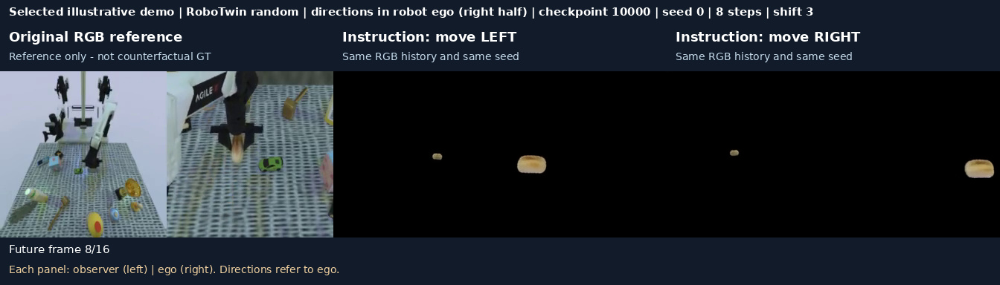
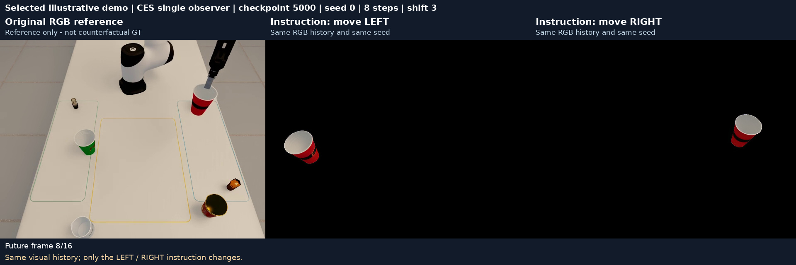

# OVP：语言指令跟随 Demo

[项目首页](../README.md) · [RoboTwin random Demo](#robotwin-random-demo) · [CES Demo](#cse-demo)

**Language-Conditioned Object-Only Video Prediction（OVP）**

本页展示 RoboTwin random 和 CES 两个数据域的**选定定性样例**：固定同一段全景 RGB 历史和同一个预测起点，仅将动作计划中的移动方向从“向左”改为“向右”，观察黑背景物体预测如何变化。CES 的左右指 observer 图像方向；RoboTwin random 的左右指拼接画面右半部分的 robot ego 图像方向。同一次物体运动在两个相机中的投影可能不同。

这些视频用于直观展示模型对语言条件的响应，不代表完整测试集成功率，也不用于证明训练带来的因果提升或机器人已经具备相应的物理控制能力。

## Checkpoint 与训练数据

训练链路为：

**VPP2 Stage-2 → RoboTwin clean 10k → RoboTwin random 10k → CES 5k**

步数按每个数据阶段分别计数：random 的 10k 是在 clean 10k 权重基础上额外训练 10,000 次参数更新；CES 的 5k 是在 random 10k 权重基础上再训练 5,000 次参数更新。它们不是同一次训练中的第 10k、10k、5k 步。各阶段只训练 Video DiT，VAE、CLIP 和文本编码器保持冻结。

| Checkpoint | 本阶段训练数据 | 训练 / 验证 / 测试 episode | 视频视角与排列 | 每帧宽×高 |
|---|---|---|---|---|
| clean 10k | RoboTwin clean，50 个任务 | 2,155 train / 240 test；排除 105 条待复核 prompt | 左 observer，右 ego；每个视角 224×224 | 448×224 |
| random 10k | RoboTwin random，50 个任务 | 2,248 train；250 条留出数据再分为 100 validation / 150 final-test；排除 2 条待复核 prompt | 左 observer，右 ego；每个视角 224×224 | 448×224 |
| CES 5k | `ces-pick-place-20261028`，7 类目标物体 | 568 train / 63 test；排除 69 条待复核 prompt | 单 observer，无视角拼接 | 640×480 |

RoboTwin 的 observer 与 ego 分别直接缩放至 224×224，再水平拼接；全景 RGB 与物体监督视频使用同样的处理与顺序，不做裁剪或翻转。CES 保持原生分辨率，使用 `observation.images.table_overview` 作为全景 RGB 输入，使用 `observation.images.mask_object_amodal` 监督该 episode 指定的目标物体，不使用 wrist 视频。

| Checkpoint | 模型与恢复说明 | 已核验的 Hugging Face 备份 |
|---|---|---|
| clean 10k | [clean 权重与恢复](../backups/step_010000_20261026/README.md) | [固定 revision `fea338d4`](https://huggingface.co/elephantsbug/vpp2-obj-generation-step10000/tree/fea338d4a21fa7c296d7d3729be39b0720d8ea4d) |
| random 10k | [random checkpoint 说明](robotwin_random_step10000_checkpoint.md) | [固定 revision `b52fa488`](https://huggingface.co/elephantsbug/vpp2-object-video-random-step10000-20261102/tree/b52fa4880298e7b3d856ca575eb4b3dc59289a2b) |
| CES 5k | [CES checkpoint 与评测](cse_step5000_checkpoint.md) | [固定 revision `fa714f0b`](https://huggingface.co/elephantsbug/vpp2-obj-generation-cse-step5000/tree/fa714f0b560606dba82d76b099bfd0b0e88d246d) |

截至 2026-11-11 核对，上述三个 Hugging Face 仓库均已公开；各模型页保留准确文件大小、SHA-256 和固定版本下载命令。权重保存 Video DiT 参数，不包含完整优化器状态或全部冻结组件。random 的 HF 备份另含训练配置，但运行时存在未完整收录的源码修改；CES 远端权重备份仅含 `step_005000.pt`，运行还需支持 `[480, 640]`（高、宽）的 CES 代码和配置。发布这两个展示视频不等于已发布完整推理环境。

## 模型输入与视频阅读方式

三个阶段采用相同的 **9 帧条件 + 16 帧未来** 时间布局：

- 条件：episode 全景 RGB 首帧 `I0`，加上 `I(s-210), I(s-180), …, I(s)` 共 8 帧历史；history stride 为 30。
- 预测：`O(s+5), O(s+10), …, O(s+80)`，共 16 帧物体视频；prediction stride 为 5。
- 历史不足时用 episode 首帧补齐。全景 RGB 和物体视频使用共享帧索引；RoboTwin 的重复时间戳通过既有去重索引处理，CES 使用原始连续帧索引。

模型接收全景 RGB 首帧、历史和英文动作计划，输出黑背景物体视频；物体 GT 和未来全景 RGB 不作为预测输入。CES 的源视频为 30 fps，因此 stride 30 对应 1 秒，16 帧未来覆盖到锚点后约 2.67 秒。

Demo **先播放截至预测锚点的全景 RGB 历史**，帮助理解物体的初始位置和当前状态；模型实际接收上述抽样的 9 帧条件。随后切换到未来三栏对比：

| 左栏 | 中栏 | 右栏 |
|---|---|---|
| 原任务录像中的未来全景 RGB，供场景与时间参考 | “向左移动”prompt 的物体预测 | “向右移动”prompt 的物体预测 |

左栏只有数据集中原本执行过的轨迹，**不是新左右指令各自的 GT**。两组预测共享 RGB 条件、checkpoint、seed 和推理设置，仅改变 prompt 中的方向。黑背景输出能展示物体身份、轨迹和可见性；没有桌面和机械臂画面，不能据此确认接触桌面、松爪或真实放置成功。

<a id="robotwin-random-demo"></a>

## RoboTwin random：同一面包卷，切换左右方向

[](../assets/demos/robotwin_random_direction_demo.mp4)

[打开 RoboTwin random Demo 视频](../assets/demos/robotwin_random_direction_demo.mp4)

| 项目 | 设置 |
|---|---|
| 模型 | RoboTwin random 10k checkpoint |
| 数据划分 | 来自固定 150 条 final-test episode 中的 1 条 |
| 测试 episode | `place_a2b_left/episode_0000007` |
| 预测锚点 | 去重索引 175，对应原视频 source frame 179 |
| 目标物体 | 已被夹起的面包卷（bread roll） |
| 条件 | 相同的全景 RGB 首帧和历史；保留左 observer、右 ego 的双视角排列 |
| 变量 | 同一英文模板中的两处方向词，均为 left 或均为 right |
| 方向参照 | 拼接画面右半幅的 robot ego 视角 |
| 推理 | 8 步去噪，shift=3，seed=0 |

这组选定结果中，面包卷在 ego 视角分别向左和向右连续移动，observer 视角显示同一运动的对应投影。物体在两路预测中保持可辨，移动距离与姿态变化由模型生成，不要求两侧轨迹对称。

两条实际输入 prompt 共用以下模板，`{direction}` 在同一条指令内统一替换为 `left` 或 `right`：

```text
Predict future object-only video from full-scene RGB history and the first frame. Black background; observer left, ego right. The bread roll moves horizontally toward the {direction} side of the robot ego view, away from its current position, then is lowered onto the table. Its final position is on the {direction} side of the ego view.
```

<a id="cse-demo"></a>

## CES：同一已抬起红杯，切换左右方向

[](../assets/demos/cse_direction_demo.mp4)

[打开 CES Demo 视频](../assets/demos/cse_direction_demo.mp4)

| 项目 | 设置 |
|---|---|
| 模型 | CES 5k checkpoint |
| 测试 episode | `red_cup/episode_0000592` |
| 预测锚点 | frame 175，杯子已明显抬起、处于横向运输前的稳定片段 |
| 条件 | 同一 episode 首帧与同一组全景 RGB 历史 |
| 变量 | prompt 中相对当前位置的向左 / 向右移动 |
| 推理 | 8 步去噪，shift=3，seed=0 |

这组选定结果中，两条预测保持红杯身份，并呈现不同方向的整杯移动。它展示的是在同一视觉条件下改变方向描述后，预测轨迹随语言条件变化；这里不将其解释为真实机器人已执行左右放置。

两条实际输入 prompt 共用以下模板，将 `{direction}` 替换为 `left` 或 `right`：

```text
Predict future amodal object-only RGB video from full-scene observer RGB history and the first frame. Single fixed observer view; black background. The gripper holds the red cup above the table, moves it to the {direction} of its current position in the observer view, then lowers it onto the table and releases it upright.
```

## Seed 的选择也很重要

Seed 决定推理初始噪声，可能影响物体运动轨迹、可见性和末尾稳定性。做左右 prompt 的成对对比时，应使用相同 seed 和完全一致的其他推理设置，避免将随机噪声差异误认为语言效果。

本页两个 demo 均展示 seed=0，并分别在 seed=0/1/2 下进行了候选检查。已有 RoboTwin random 候选检查记录中，seed=2 的右向指令出现过方向不符；因此不能用展示的 seed=0 推断所有 seed 都能正确跟随。这是选定场景与 seed 的定性样例，不能代表所有窗口或所有 seed。系统比较应固定测试窗口，在多个 seed 下重复左右两组预测，再共同检查运动方向、物体身份与轨迹稳定性；展示视频和多 seed 统计承担不同的用途。

## 本地来源记录

- clean 初始化与数据配置：`runs/obj_video_train_v1/config.yaml`。
- random 初始化配置：`runs/obj_video_random_lr2e6_trial_v1/config.yaml`；后续训练通过完整 trainer state 接续至 random 10k。
- CES 初始化配置：`runs/obj_video_cse_trial_v2/config.yaml`；5k 续训配置：`runs/obj_video_cse_continue_5000_v1/resume_config.yaml`。
- RoboTwin random 面包卷方向对比：`runs/robotwin_random_direction_demo_v2/`，展示 `place_a2b_left/episode_0000007`、seed=0。
- CES 红杯方向对比：`runs/cse_direction_switch_v1/`，包含生成 trace、预测数组和逐帧视觉检查记录（由助手记录）。
- HF 核验：clean / CES 的本地上传核验记录与三个仓库的远端文件元数据，固定版本及下载校验见上方各模型页。random 的 `checkpoint.json` 和 `SHA256SUMS` 已保存在对应 HF 仓库。

这些 `runs/` 路径用于定位本地实验记录，不表示完整实验产物已经上传到代码或模型仓库。
